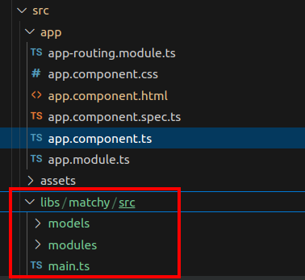

# Matchy Library

This library provides functionality to upload CSV files, match the file header with existing options, and validate the contents of the CSV files based on predefined conditions. The validation includes checking for mandatory fields, maximum or minimum length, and data type (string, integer, boolean, float, or regex pattern).

**Framework Support**: Works with Angular, React, Vue, Vanilla JS, and any framework that supports Web Components.

## Features

1- Upload CSV , XLS and XSLX files

2- Match file header with existing options

3- Validate cells based on conditions

4- Directly update cells without altering the file

5- Visual indication of validation status (red for invalid, green for valid)

6- Download edited data with all changes applied


**UI/UX features and options** 
1-  Download edited data with all changes applied
2- Customizable buttons (text, style, colors)
3- Pagination for large datasets (configurable)
4-  Live error display with dynamic counter


## Overview

##### Option fields:

`display_value`: This field represents the value displayed to users. For instance, if the field represents a person's first name, the display_value might be "First Name".

`value`: The value field corresponds to the actual field name or identifier used in your database or backend systems. For example, if the field represents a person's first name and the database column is named "first_name", then value would be "first_name".

`mandatory`: This is a boolean field indicating whether the field is mandatory or required. If mandatory is set to true, it means that the field must have a value provided for it to be considered valid.

`type`: The type field specifies the data type of the field. It is typically represented by an enumeration Field Type with possible values (float, integer, string)

`conditions`: This field represents an array of conditions that need to be satisfied for the field to be considered valid.

##### Condition fields:

`property`: This field is an enum representing the property of the data being evaluated in the condition. It can take one of three values:

- **value**: Indicates that the condition applies directly to the value itself.
- **regex**: Specifies that the condition involves a regular expression pattern match.
- **length**: Denotes that the condition pertains to the length of the value, such as string length or array length.

`comparer`: This field is an enum representing the comparison operation to be applied in the condition. It can take one of six values:

- **gt**: Greater than comparison.
- **gte**: Greater than or equal to comparison.
- **lt**: Less than comparison.
- **lte**: Less than or equal to comparison.
- **e**: Equality comparison.
- **in**: Membership comparison, checking if the value exists in a specified list or range.
value: This field represents the value against which the condition is evaluated. It can be a number, a string, or an array of strings. The type of value depends on the context of the condition and the property being evaluated.

`custom_fail_message`: This field contains a custom failure message that can be displayed if the condition is not met. It is optional and can be either a string or null. If provided, this message overrides any default failure message associated with the condition.

These fields collectively define the criteria for validating data against specific conditions. They allow for flexible and customizable validation rules to ensure that data meets the required criteria within the application.

## Using Matchy with Angular/React
First you need to copy the `src` folder from this repository to your angular app.

In this example, this is my project structure


1- create a new component (⚠️ ⚠️ ⚠️ ⚠️ don't name it matchy, details: "app-matchy" is already defined here https://github.com/RaoufGhrissi/csv_matchy/blob/9151790e44e84f0d83c93f691aa2bb2ae3923e72/src/main.ts#L613)


```typescript
import { Matchy } from './libs/matchy/src/main';
import { Option } from './libs/matchy/src/models/classes/option';
import { FieldType } from './libs/matchy/src/models/enums/field_type';

// Define your expected columns
const options = [
  new Option('First Name', 'firstName', true, FieldType.string),
  new Option('Last Name', 'lastName', true, FieldType.string),
  new Option('Email', 'email', false, FieldType.string),
  new Option('Age', 'age', false, FieldType.integer),
];

// Create the component
const matchy = new Matchy(options);
document.body.appendChild(matchy);
```

## Button Customization

You can customize buttons by passing a configuration object:

```typescript
const config = {
  autoMap: true, // Enable auto-mapping (default: true)
  pagination: {
    enabled: true, // Enable pagination (default: true)
    itemsPerPage: 20 // Items per page (default: 20)
  },
  buttons: {
    upload: {
      text: 'Upload CSV',
      className: 'btn btn-primary custom-upload',
      style: 'background: #007bff; color: white; padding: 10px 20px;'
    },
    validate: {
      text: 'Check Data',
      className: 'btn btn-warning',
      style: 'background: #ffc107; color: black;'
    },
    submit: {
      text: 'Send Data',
      className: 'btn btn-success',
      style: 'background: #28a745; color: white; font-weight: bold;'
    },
    reset: {
      text: 'Clear All',
      className: 'btn btn-secondary'
    },
    export: {
      text: 'Download CSV',
      className: 'btn btn-info',
      style: 'background: #17a2b8; color: white;'
    }
  }
};

const matchy = new Matchy(options, config);
```

## Using Your Own Button Styles

You can use any CSS framework or custom styles:

```typescript
// Using Tailwind CSS
const config = {
  buttons: {
    upload: {
      text: 'Upload',
      className: 'bg-blue-500 hover:bg-blue-700 text-white font-bold py-2 px-4 rounded'
    },
    submit: {
      text: 'Submit',
      className: 'bg-green-500 hover:bg-green-700 text-white font-bold py-2 px-4 rounded'
    }
  }
};

// Using PrimeNG styles
const primeConfig = {
  buttons: {
    upload: {
      text: 'Upload',
      className: 'p-button p-button-raised p-button-primary'
    },
    submit: {
      text: 'Submit',
      className: 'p-button p-button-raised p-button-success'
    }
  }
};
```

## Auto-Mapping Feature

The component automatically maps CSV headers to your defined options based on string similarity:

```typescript
// CSV Headers: firstName, lastName, emailAddress, userAge
// Options: First Name, Last Name, Email, Age

// Auto-mapping will automatically match:
// firstName -> First Name (exact match)
// lastName -> Last Name (exact match)
// emailAddress -> Email (partial match)
// userAge -> Age (partial match)

// You can disable auto-mapping:
const matchy = new Matchy(options, { autoMap: false });
```

## Adding Validation Rules

```typescript
import { Condition } from './libs/matchy/src/models/classes/condition';
import { Comparer } from './libs/matchy/src/models/enums/comparer';
import { ConditonProperty } from './libs/matchy/src/models/enums/conditon_property';

// Email validation with regex
const emailOption = new Option(
  'Email',
  'email',
  true,
  FieldType.string,
  [
    new Condition(
      ConditonProperty.regex,
      '^[\\w-\\.]+@([\\w-]+\\.)+[\\w-]{2,4}$',
      Comparer.e,
      'Invalid email format'
    )
  ]
);

// Age validation (between 18 and 99)
const ageOption = new Option(
  'Age',
  'age',
  true,
  FieldType.integer,
  [
    new Condition(
      ConditonProperty.value,
      18,
      Comparer.gte,
      'Age must be at least 18'
    ),
    new Condition(
      ConditonProperty.value,
      99,
      Comparer.lte,
      'Age must be less than 100'
    )
  ]
);
```

## Handling Submit

Override the `submit` method to handle the validated data:

```typescript
const matchy = new Matchy(options, config);

matchy.submit = async (data) => {
  console.log('Validated data:', data);
  
  // Send to your API
  try {
    const response = await fetch('/api/upload', {
      method: 'POST',
      headers: { 'Content-Type': 'application/json' },
      body: JSON.stringify(data)
    });
    
    if (response.ok) {
      alert('Data uploaded successfully!');
    }
  } catch (error) {
    console.error('Upload failed:', error);
  }
};
```

## Configuration Options
pagination.enabled` | boolean | `true` | Enable pagination for table |
| `pagination.itemsPerPage` | number | `20` | Number of rows per page |
| `buttons.upload.text` | string | `'Upload'` | Upload button text |
| `buttons.upload.className` | string | `'btn btn-primary'` | Upload button CSS classes |
| `buttons.upload.style` | string | - | Upload button inline styles |
| `buttons.validate.text` | string | `'Validate'` | Validate button text |
| `buttons.validate.className` | string | `'btn btn-primary'` | Validate button CSS classes |
| `buttons.validate.style` | string | - | Validate button inline styles |
| `buttons.submit.text` | string | `'Submit'` | Submit button text |
| `buttons.submit.className` | string | `'btn btn-success'` | Submit button CSS classes |
| `buttons.submit.style` | string | - | Submit button inline styles |
| `buttons.reset.text` | string | `'Reset'` | Reset button text |
| `buttons.reset.className` | string | `'btn btn-secondary'` | Reset button CSS classes |
| `buttons.reset.style` | string | - | Reset button inline styles |
| `buttons.export.text` | string | `'Export CSV'` | Export button text |
| `buttons.export.className` | string | `'btn btn-info'` | Export button CSS classes |
| `buttons.export.style` | string | - | Export button inline styles |

## Export Feature

The **Export CSV** button allows you to download the edited data with all changes applied:

### What Gets Exported
- ✅ Only **mapped columns** (unmapped columns are excluded)
- ✅ All **edited cell values** (your changes are preserved)
- ✅ **Deleted rows are excluded** (only active rows exported)
- ✅ Uses column **display names** as headers
- ✅ Clean CSV format with proper escaping

### How to Use
1. Upload and map your file
2. Edit cells as needed
3. Delete unwanted rows
4. Click **Export CSV** button
5. File downloads automatically as `exported_data_[timestamp].csv`

### Example
```typescript
// Before: Excel file with 10 columns
// After mapping: 6 columns selected
// After editing: 3 cells changed, 2 rows deleted
// Export result: Clean CSV with 6 columns, edited values, and only valid rows
```

**Note**: Export is available immediately after file upload (no validation required).

## Button State Management

The component automatically manages button states based on workflow:

1. **Initial State**: All buttons disabled and hidden
2. **After File Selection**: Upload button enabled
3. **After Upload**: 
   - Validate button enabled ONLY if all required fields are mapped
   - Reset button visible
   - **Export button visible and enabled** (can export anytime after upload)
4. **After Validation**: 
   - Validate button disabled
   - Submit button enabled
   - Export button remains available
   - Error display shows validation status
5. **On Submit Attempt**: 
   - Re-validates all data
   - If errors exist, prevents submission and shows error display
   - If no errors, proceeds with submission

```typescript
// Example: Check required field mapping
const hasAllRequired = matchy.checkRequiredFieldsMapped();

// Check validation errors
const errorCount = matchy.countValidationErrors();
```

## Pagination

Control pagination for large CSV files:

```typescript
// Enable with custom page size
const config = {
  pagination: {
    enabled: true,
    itemsPerPage: 50 // Show 50 rows per page
  }
};

// Disable pagination
const config = {
  pagination: {
    enabled: false
  }
};
```

The pagination controls show:
- Current page and total pages
- Row range being displayed
- Previous/Next navigation buttons

## Validation and Error Handling

The component performs comprehensive validation:

### During Validation Phase
- Click "Validate" button to check all data
- Invalid cells are highlighted in red with a warning icon (⚠)
- Hover over invalid cells to see error message
- **Error display** shows live error count that updates as you fix issues
- Submit button is automatically disabled when errors exist

### Before Submission
- Automatic re-validation when "Submit" is clicked
- Submission is blocked if any validation errors exist
- **Live error counter** decrements as you correct cells
- Submit button is only enabled when all errors are fixed (0 errors)

## Framework Integration

### Angular
See [USAGE_EXAMPLE.ts](./USAGE_EXAMPLE.ts) for complete Angular integration examples including:
- Integration with Angular components
- Using with PrimeNG styles
- Bootstrap styling
- Form integration

### React
See [REACT_USAGE_EXAMPLE.tsx](./REACT_USAGE_EXAMPLE.tsx) for complete React examples including:
- Basic React component integration
- Custom React hooks (`useMatchy`)
- Tailwind CSS styling
- Material-UI styling
- State management integration
- TypeScript with strict typing

### Vue/Vanilla JS
Since Matchy is a native Web Component, it works seamlessly with any framework:

```javascript
// Vanilla JS
const matchy = new Matchy(options, config);
document.getElementById('container').appendChild(matchy);

// Vue 3
<template>
  <div ref="matchyContainer"></div>
</template>

<script setup>
import { ref, onMounted } from 'vue';
import { Matchy } from './libs/matchy/src/main';

const matchyContainer = ref(null);

onMounted(() => {
  const matchy = new Matchy(options, config);
  matchyContainer.value.appendChild(matchy);
});
</script>
```
## Contributing
Contributions are welcome! Please feel free to submit a pull request.
Check contributions.md for more details

## Support
For any questions or issues, please open an issue.